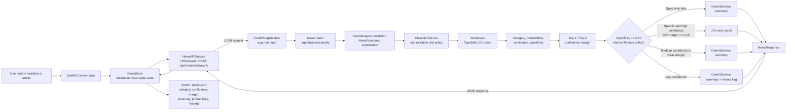

# JEV News Classifier

A SwiftUI iOS frontend backed by a Python FastAPI backend for classifying news. The backend uses JEV to determine a news category, confidence, specificity, and ambiguity, then uses Gemini to enrich results that need additional context.


## Architecture

The application is split into two cooperating layers:

- **iOS frontend:** A SwiftUI client that collects news text, sends classification requests, manages loading/error state, and presents the classification decision and supporting details.
- **Python backend:** A FastAPI service that validates requests, invokes JEV, calculates confidence and ambiguity signals, applies the routing policy, and optionally invokes Gemini for summaries.

The iOS app never calls JEV or Gemini directly. It communicates with the backend through the versioned `POST /api/v1/news/classify` endpoint. This keeps API credentials and classification policy on the server while giving the frontend a stable response contract.

### System architecture



### Backend architecture (`jev-news-classifier`)

The backend follows a layered FastAPI design:

1. **Application layer (`app/main.py`)** creates the FastAPI application, registers the news router, and exposes root and health endpoints.
2. **API layer (`app/api/routes/news.py`)** receives `NewsRequest`, calls the classifier orchestration service, and returns a validated `NewsResponse`.
3. **Schema layer (`app/models/news.py`)** validates incoming text and defines the JSON contract shared with the iOS frontend.
4. **Orchestration layer (`app/services/classifier_service.py`)** calls JEV first, derives top-1/top-2 probabilities and their margin, applies specificity and confidence thresholds, and chooses the processing path.
5. **JEV integration (`app/services/jev_service.py`)** communicates with TypeSafe JEV and returns the category, probabilities, confidence, specificity, and specificity score.
6. **Gemini integration (`app/services/gemini_service.py`)** creates summaries for non-specific, ambiguous, or lower-confidence inputs and provides safe fallback behavior when Gemini is unavailable.

### iOS frontend architecture (`NewsJev_ios`)

The iOS client uses a simple presentation/state/networking separation:

1. **View (`UI/ContentView.swift`)** collects a headline or article and renders the category, confidence level, top-two comparison, confidence margin, decision reason, processing path, summary, probabilities, and human-review status.
2. **State (`State/NewsStore.swift`)** is a `@MainActor`/`@Observable` state layer. It owns the `idle`, `loading`, `loaded`, and `error` states, cancels an in-flight request when needed, and publishes the decoded result to the view.
3. **API client (`APIServices/NewsAPIService.swift`)** builds the HTTP POST request, encodes `NewsRequest`, validates 2xx responses, maps failures to `APIError`, and decodes `NewsResponse`.
4. **Models (`Model/NewsModel.swift`)** define the Codable request and response types, including mappings between backend snake_case fields and Swift property names.
5. **Application entry point (`NewsJevApp.swift`)** creates the SwiftUI application and presents `ContentView`.

### End-to-end request flow

1. The user enters news text in `ContentView` and taps **Classify News**.
2. `NewsStore` changes to `loading` and asks `NewsAPIService` to classify the text.
3. `NewsAPIService` sends JSON to `POST /api/v1/news/classify`.
4. FastAPI validates the request using `NewsRequest` and delegates to `ClassifierService`.
5. `JevService` classifies the text as `technology`, `business`, `sports`, `politics`, `entertainment`, `science`, `health`, or `other` and returns probability signals plus specificity.
6. `ClassifierService` calculates the top-1/top-2 confidence margin and applies the routing policy.
7. If the result is routed to Gemini, `GeminiService` generates a summary. Gemini failures produce a safe fallback summary and require human review.
8. The backend serializes `NewsResponse`; the iOS client decodes it and `ContentView` renders the result card.

### Backend decision policy

- **Non-specific input (`specificity_score < 0.50`):** invoke Gemini and set `needs_human_review = true`.
- **High confidence (`confidence >= 0.90`) with a strong margin (`margin >= 0.15`):** return a `jev_only` result without human review.
- **Medium confidence (`confidence >= 0.60`) or a weak top-two margin (`margin < 0.15`):** invoke Gemini and return `jev_then_gemini`.
- **Low confidence (`confidence < 0.60`):** invoke Gemini, return `jev_then_gemini`, and set `needs_human_review = true`.
- **Gemini failure:** return a fallback summary and set `needs_human_review = true`.

## Repository layout

```text
.
├── NewsJev_ios/
│   ├── NewsJev.xcodeproj/              # Xcode project
│   └── NewsJev/
│       ├── NewsJevApp.swift            # SwiftUI application entry point
│       ├── UI/ContentView.swift        # Input form and result presentation
│       ├── State/NewsStore.swift       # Observable state and actions
│       ├── Model/NewsModel.swift       # Codable API models
│       └── APIServices/
│           └── NewsAPIService.swift    # HTTP client and error handling
├── jev-news-classifier/
│   ├── app/
│   │   ├── main.py                     # FastAPI app and health endpoints
│   │   ├── api/routes/news.py          # News classification route
│   │   ├── models/news.py              # Pydantic schemas
│   │   └── services/
│   │       ├── classifier_service.py  # Routing and thresholds
│   │       ├── jev_service.py         # TypeSafe JEV classification
│   │       └── gemini_service.py      # Gemini summaries and fallbacks
│   ├── pyproject.toml                  # Python project metadata/dependencies
│   ├── uv.lock                         # Locked dependency resolution
│   └── tests/test_news.py              # Backend tests
├── README.md
```

## Technology stack

- **iOS frontend:** Swift 5, SwiftUI, Observation, URLSession
- **Backend:** Python 3.12+, FastAPI, Uvicorn, Pydantic
- **AI services:** TypeSafe JEV (`jev-latest`) for classification and specificity; Google Gemini (`gemini-3.6-flash`) for summaries
- **Dependency management:** `uv` with `pyproject.toml` and `uv.lock`

## Backend setup

### Prerequisites

- Python 3.12 or newer
- [`uv`](https://docs.astral.sh/uv/)
- `TYPESAFE_API_KEY`
- `GOOGLE_API_KEY`

Create `jev-news-classifier/.env`:

```env
TYPESAFE_API_KEY=your_typesafe_api_key
GOOGLE_API_KEY=your_google_api_key
```

Do not commit `.env` or API keys.

### Install and run

```bash
cd jev-news-classifier
uv sync
uv run uvicorn app.main:app --reload
```

The API is available at `http://127.0.0.1:8000`. Interactive documentation is available at `http://127.0.0.1:8000/docs`.

### Health check

```bash
curl http://127.0.0.1:8000/health
```

### Classify news with curl

```bash
curl -X POST http://127.0.0.1:8000/api/v1/news/classify \
  -H "Content-Type: application/json" \
  -d '{"text":"Apple announced a new artificial intelligence feature for its devices."}'
```

The response includes `category`, `confidence`, `top_category`, `top_confidence`, `second_category`, `second_confidence`, `confidence_margin`, `probabilities`, `summary`, `needs_human_review`, `processing_path`, `specificity`, `specificity_score`, and `decision_reason`.

## iOS frontend setup

1. Start the backend using the commands above.
2. Open `NewsJev_ios/NewsJev.xcodeproj` in Xcode.
3. Select the `NewsJev` scheme and an iOS Simulator or connected device.
4. Build and run the app.
5. Enter a headline or article and tap **Classify News**.

The development API URL is configured in `NewsJev_ios/NewsJev/APIServices/NewsAPIService.swift` as `http://127.0.0.1:8000`. This works for an iOS Simulator running on the same Mac. For a physical device, replace it with the Mac's local network address and configure the appropriate network permissions.

## API reference

### `POST /api/v1/news/classify`

Request:

```json
{
  "text": "A news headline or article with at least five characters"
}
```

Response shape:

```json
{
  "category": "technology",
  "confidence": 0.95,
  "top_category": "technology",
  "top_confidence": 0.95,
  "second_category": "business",
  "second_confidence": 0.02,
  "confidence_margin": 0.93,
  "probabilities": {
    "technology": 0.95,
    "business": 0.02
  },
  "summary": "High-confidence JEV classification.",
  "needs_human_review": false,
  "processing_path": "jev_only",
  "specificity": "specific",
  "specificity_score": 0.98,
  "decision_reason": "high_confidence_specific"
}
```

## Testing

```bash
cd jev-news-classifier
uv run pytest
```

## Current development notes

- The iOS frontend currently targets a local backend URL rather than a deployed API.
- The backend imports `load_dotenv` from `python-dotenv`; if `uv sync` reports that this package is missing, add `python-dotenv` to the project dependencies and refresh `uv.lock`.
- Python bytecode under `app/**/__pycache__` is generated and should generally be excluded from version control.

## License

No license has been specified yet.
