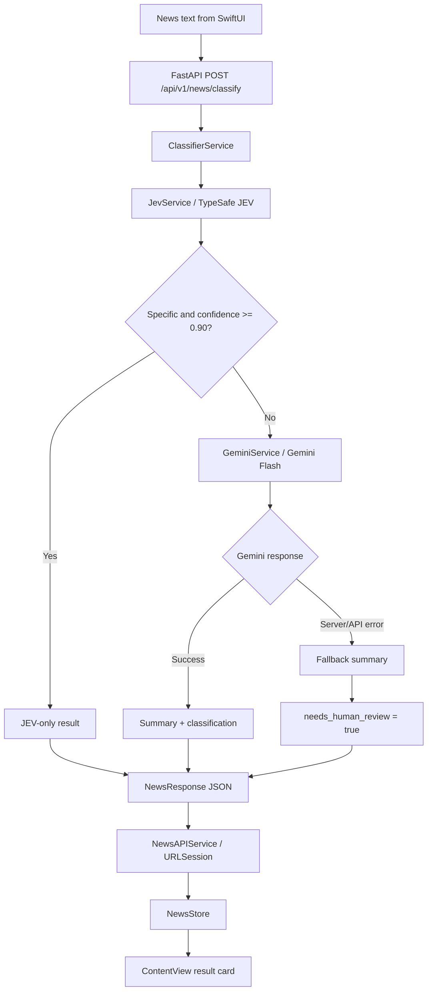

# JEV News Classifier

A SwiftUI iOS app backed by a Python FastAPI service for classifying news. The backend uses JEV to determine a news category and specificity, then routes lower-confidence or ambiguous inputs to Google Gemini for a concise summary and human-review signal. The iOS client presents the category, confidence, probabilities, processing path, summary, and review status.

## Architecture

The classification pipeline uses JEV as the first-stage classifier. It evaluates both the news category and whether the input is specific enough to classify. Medium- or low-confidence and non-specific inputs are enriched with a Gemini summary. If Gemini returns a server/API error, the backend returns a safe fallback summary and marks the result for human review.



### Component view

```mermaid
flowchart LR
    subgraph iOS[NewsJev iOS app]
        View[ContentView.swift\nSwiftUI presentation]
        Store[NewsStore.swift\n@Observable state]
        APIClient[NewsAPIService.swift\nURLSession + JSON]
        Model[NewsModel.swift\nCodable models]
        View --> Store --> APIClient
        APIClient --> Model
    end

    subgraph Backend[jev-news-classifier]
        Main[app/main.py\nFastAPI application]
        Route[app/api/routes/news.py\nHTTP route]
        Schema[app/models/news.py\nPydantic schemas]
        Classifier[app/services/classifier_service.py\nconfidence routing]
        Main --> Route --> Schema
        Route --> Classifier
    end

    JEV[JevService\nTypeSafe SDK]
    Gemini[GeminiService\nGoogle GenAI SDK]

    APIClient -- HTTP POST --> Main
    Classifier --> JEV
    Classifier --> Gemini
    JEV --> Classifier
    Gemini --> Classifier
```

### Request flow

1. `ContentView` collects the news text and asks `NewsStore` to classify it.
2. `NewsAPIService` sends the text as JSON to `POST /api/v1/news/classify`.
3. FastAPI validates the request with `NewsRequest` and delegates to `ClassifierService`.
4. `JevService` classifies the text into one of `technology`, `business`, `sports`, `politics`, `entertainment`, `science`, `health`, or `other`, and evaluates specificity.
5. `ClassifierService` applies the confidence policy: high-confidence specific results use JEV only; medium/low-confidence or non-specific results call `GeminiService`.
6. `GeminiService` returns a concise summary on success. If Gemini is unavailable, it returns a fallback message and the result requires human review.
7. The response is decoded into `NewsResponse` and rendered by the SwiftUI result card.

## Repository layout

```text
.
├── NewsJev_ios/
│   ├── NewsJev.xcodeproj/          # Xcode project
│   └── NewsJev/
│       ├── NewsJevApp.swift        # SwiftUI application entry point
│       ├── UI/ContentView.swift    # Input form, loading, errors, and results
│       ├── State/NewsStore.swift   # Main-actor observable state and actions
│       ├── Model/NewsModel.swift   # Codable API request/response models
│       └── APIServices/
│           └── NewsAPIService.swift # HTTP client and API error handling
├── jev-news-classifier/
│   ├── app/
│   │   ├── main.py                 # FastAPI app and health endpoints
│   │   ├── api/routes/news.py      # News classification route
│   │   ├── models/news.py          # Pydantic request/response schemas
│   │   └── services/
│   │       ├── classifier_service.py # Routing and confidence thresholds
│   │       ├── jev_service.py        # TypeSafe JEV classification
│   │       └── gemini_service.py     # Gemini summarization and fallbacks
│   ├── pyproject.toml              # Python 3.12 project metadata/dependencies
│   ├── uv.lock                     # Locked Python dependency resolution
│   └── tests/test_news.py           # Backend test module
└── README.md
```

## Technology stack

- **iOS:** Swift 5, SwiftUI, Observation, URLSession
- **Backend:** Python 3.12+, FastAPI, Uvicorn, Pydantic
- **AI services:** TypeSafe JEV (`jev-1.13.0`) for classification and specificity; Google Gemini (`gemini-3.6-flash`) for summaries
- **Dependency management:** `uv` with `pyproject.toml` and `uv.lock`

## Backend setup

### Prerequisites

- Python 3.12 or newer
- [`uv`](https://docs.astral.sh/uv/)
- `TYPESAFE_API_KEY`
- `GOOGLE_API_KEY`

The services load environment variables from a `.env` file in the backend working directory. Create `jev-news-classifier/.env`:

```env
TYPESAFE_API_KEY=your_typesafe_api_key
GOOGLE_API_KEY=your_google_api_key
```

Do not commit `.env` or API keys.

### Install and run

```bash
cd jev-news-classifier
uv sync
uv run uvicorn app.main:app --reload
```

The API is then available at `http://127.0.0.1:8000`. FastAPI's interactive documentation is available at `http://127.0.0.1:8000/docs`.

### Health check

```bash
curl http://127.0.0.1:8000/health
```

Expected response:

```json
{
  "status": "ok",
  "service": "jev-news-classifier"
}
```

### Classify news with curl

```bash
curl -X POST http://127.0.0.1:8000/api/v1/news/classify \
  -H "Content-Type: application/json" \
  -d '{"text":"Apple announced a new artificial intelligence feature for its devices."}'
```

The response includes `category`, `confidence`, `probabilities`, `summary`, `needs_human_review`, `processing_path`, `specificity`, and `specificity_confidence`.

## iOS setup

1. Start the backend locally using the commands above.
2. Open `NewsJev_ios/NewsJev.xcodeproj` in Xcode.
3. Select the `NewsJev` scheme and an iOS Simulator or connected device.
4. Build and run the app.
5. Enter a headline or article and tap **Classify News**.

The current development API URL is configured in `NewsJev_ios/NewsJev/APIServices/NewsAPIService.swift` as `http://127.0.0.1:8000`. This works for an iOS Simulator running on the same Mac. For a physical device, replace it with the Mac's LAN IP address and ensure the device can reach the backend.

## API reference

### `POST /api/v1/news/classify`

Request:

```json
{
  "text": "A news headline or article with at least five characters"
}
```

Response shape:

```json
{
  "category": "technology",
  "confidence": 0.95,
  "probabilities": {
    "technology": 0.95,
    "business": 0.02
  },
  "summary": "...",
  "needs_human_review": false,
  "processing_path": "jev_only",
  "specificity": "specific",
  "specificity_confidence": 0.98
}
```

### Processing policy

- **High confidence (`>= 0.90`):** JEV classification only; no human review is required.
- **Medium confidence (`>= 0.60` and `< 0.90`):** JEV classification plus Gemini summary.
- **Low confidence (`< 0.60`):** JEV classification plus Gemini summary and human review.
- **Non-specific input:** Gemini summary and human review, regardless of category confidence.
- **Gemini server/API failure:** A fallback summary is returned and the result requires human review.

## Testing

Run the backend test suite from the backend directory:

```bash
cd jev-news-classifier
uv run pytest
```

## Current development notes

- The iOS client currently targets a local backend URL rather than a deployed API.
- The backend imports `load_dotenv` from `python-dotenv`; if `uv sync` reports that this package is missing, add `python-dotenv` to the project dependencies and refresh `uv.lock`.
- The repository includes Python bytecode under `app/**/__pycache__`; these generated files are not part of the runtime architecture and should generally be excluded from version control.

## License

No license has been specified yet.
